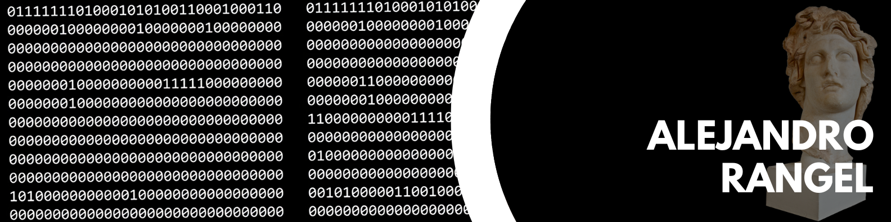

<!-- STYLE: Swiss neo-industrial: #FC4904 | BLACK #000000 | WHITE #FFFFFF Rule: Orange only for "signal" moments (current projects + CTA). -->

Hi, I'm Alejandro 👋

● Founder, Anticipation Technology | ● Indie builder

Shipping open-source “drops” (agents + ML notebooks), building proprietary AI tools, and developing EEG/BCI products.

Current Projects (Open Source)

● Agent
— A skeleton for building an agent, providing a basic architecture without agent libraries or frameworks.

● JARVIS
— Local-first personal agent framework inspired by Tony Stark's JARVIS, designed to evolve and assist.

Current Product (Proprietary)

● CODE_AGENT_LAIN
— Local terminal-based AI coding agent developed through research, experimentation, and custom meta-logic for task execution, context handling, tool use, and code interaction.
— Two versions developed and released as a commercial MVP for macOS and Windows.

Video demo

Web Products & Client Work

● BudsiDesk
— Full SaaS platform built from scratch for a private client.
Includes authentication, payment gateway, user system, invoice OCR processing, dashboards, and dynamic templates.

● Anticipation Technology
— Official website and ecosystem interface for EEG/BCI hardware, AI tools, and services.

● omarketings
— Marketing website deployed in June 2026 for email campaign workflows.

Machine Learning

● Stock Predictor — LSTM + technical indicators → probability of up/down trend.

● ML-Encryption — Autoencoder-based encryption layers for sensitive-data experiments.

● ML-PDF-Scan — Malicious PDF detection using OCR + computer vision + classification.

● ML-LLM-Bank — Lightweight banking-assistant LLM prototype.

● ML-View — CNN image-recognition demo using CIFAR-10.

Neurotechnology (AnticipationTech — Service BCI)

Anticipation Technology builds EEG/BCI hardware + web services within the Prometeo Tiara ecosystem.
Visit the Anticipation Technology website.

EEG demo videos
EEG signals on PC (Prometeo Tiara)
Turning on a light with your mind (PC)
3D brainwave projection (short)
Sponsor (after you’ve seen the work)

Connect
Email: dev.alejandro5@gmail.com
LinkedIn: Alejandro Rangel
YouTube: Palabra Con Exa Virtual
GitHub: @Al-iskander2

     

Education & Professional Experience
Education
Higher Diploma in Data Analytics (Level 8) | City College, Dublin | Sep 2024 – Aug 2025
Computer Science Coursework | HarvardX (CS50x, CS50W, CS50AI) | 2023 – 2024
Master’s in Philosophy of Culture | Universidad Michoacana, México | 2021 – 2023
Bachelor’s Degree in Philosophy | Universidad Michoacana, México | 2014 – 2018
Professional Experience
Founder & Software Engineer | Anticipation Technology | Jan 2026 – Present
Developing AI/LLM software, agent-based tools, and EEG/BCI products.
Full-Stack Developer | BudsiDesk | Jul 2025 – Nov 2025
End-to-end SaaS platform including authentication, payment processing,
invoice OCR pipeline, dashboards, and document automation.
Business Intelligence App Developer | Koffe and Kale | Jun 2025 – Aug 2025
BI application for a multi-store retailer, focused on inventory and operational reporting.
Machine Learning Engineer Intern | Gemitic Solutions (IZuuk) | Mar 2025 – Jun 2025
Generative AI, ML pipelines, model training/evaluation, and deployment workflows.
Computer Vision Project Lead | City College | Sep 2024 – Dec 2024
Real-time sketch-to-text recognition system using CNNs, TensorFlow, and OpenCV.
Other Web Projects
Psychological Test — Interactive psychological assessment tool.
Inner Security — Mindfulness and personal-security web app.
Bird — Experimental bird-themed microsite.
Brainberry Interfaz — UI concept for a brain-computer interface.
GitHub Activity

  

  

